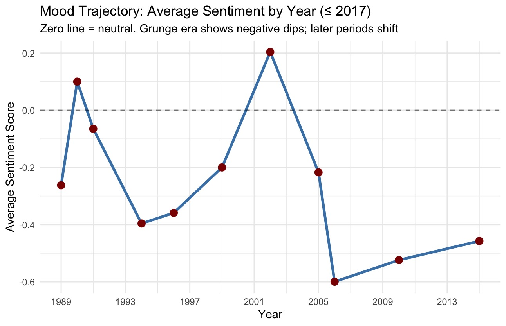

# Forensic & Behavioral Audit: The Chris Cornell Case (1964-2017)

**Author:** Michelle Berna (Industrial Civil Engineer)  
**Assistant Analyst:** TARS (AI Logic & Forensic Support)  
**Project Status:** Closed  
**Objective:** To conduct a technical and behavioral audit of the musician Chris Cornell's death, applying systems engineering, Natural Language Processing (NLP), and forensic mechanics to understand the context of his passing and the evolution of his emotional state.

---

## 📖 Introduction for the Reader

This repository is not a tabloid article, nor is it a conspiracy theory. It is a **technical audit** that applies engineering logic to analyze the tragic death of Chris Cornell.

When he passed away in 2017, the official narrative blamed a pill (Ativan) that supposedly caused a psychotic break. However, by analyzing the physical evidence, the data from his songs, and the timeline of his life, the evidence points to something far more complex: **a planned suicide, executed with full consciousness, after years of accumulated emotional fatigue.**

This repository contains the technical report, the data extracted from his audiovisual works, and the programming code (R) used to generate the graphs.

---

## 1. Executive Summary

This report documents the reassessment of the death of the subject, C. Cornell. The official hypothesis of "accidental overdose by benzodiazepines" or "psychotic break" is dismissed. It is concluded that the death was a **planned suicide**, executed through a **Partial Suspension and Anchoring System via Elastic Tension (SASPTE)** and preceded by the instrumental use of drugs (Lorazepam) to suppress the biological survival instinct and ensure cognitive precision.

The root cause of the collapse is attributed to the **cumulative fatigue of emotional materials** derived from a systemic restriction (the second marriage/environment) that began in 2003, whose force map was tattooed on his own body.

---

## 2. Methodology and Analysis Tools

*   **Forensic Failure Mechanics:** Exhaustive analysis of the SASPTE construction and the time of unconsciousness.
*   **Semiotics and Technical-Artistic Analysis:** Decoding of the right-arm tattoo as a free-body diagram.
*   **Trajectory Analysis (Big Data):** Interpretation of the sentiment graph based on **audiovisual works** (1989-2015), identifying the critical point (2006) and analyzing the derivatives.
*   **Theory of Constraints (TOC):** Evaluation of the second marriage and rushed parenthood as operational stress variables.
*   **Behavioral and Record Analysis:** Evaluation of family dynamics and memory transfer.

---

## 3. Physical and Mechanical Evidence: SASPTE Analysis

This section constitutes the material evidence that categorically refutes the hypothesis of an impulsive act or psychosis. The constructed mechanism was not an improvised knot; it was a **structural engineering system**.

*   **Material Complexity:** The subject used a resistance elastic band (exercise) and a climbing carabiner. The carabiner was meticulously wedged into the top of the bathroom door. The weight and tension of the band left a deep imprint or notch on the wooden frame.
*   **Executive Cognition and Refutation of Psychosis:** To achieve this, the subject had to:
    1.  Select materials with adequate load resistance.
    2.  Calculate the anchor point (top of the door) and the traction angle.
    3.  Execute fine motor skills to secure the carabiner.
    4.  Design an execution sequence (kneeling position) to apply gradual pressure.
    
    **An individual in a state of psychosis, acute confusion, or experiencing a benzodiazepine break is clinically incapable of executing a problem-solving and force-calculation sequence of this complexity.**
    
*   **Partial Suspension Mechanics:** The anchor height and forensic evidence indicate that the subject placed himself in a kneeling position. The minimal biological trace confirms there was no struggle or panic; there was a gradual and controlled application of pressure. This demonstrates that the subject maintained voluntary control until physiological collapse.

---

## 4. Semiotic Evidence: The Force Diagram in the Tattoo

The tattoo located on the subject's right arm is not a decorative element. Its rough and un-stylized execution is characteristic of prison tattoos, reflecting an environment of psychological coercion. The design constitutes a **Free Body Diagram**, used in engineering to calculate the tensions of a structure.

*   **The Crown (Top):** Represents the restrictive vertical load. The constant and relentless pressure (the environment, the marital restriction).
*   **The Diamond (Center):** The inorganic core. Highly compressed carbon; it represents the subject resisting tension without breaking.
*   **The Vector Γ (Gamma) - Left:** In solid mechanics, Gamma represents the **fracture energy** or a material's capacity to absorb energy and deform before breaking (damping). In the subject, it was his resilience: music, isolation, and the use of drugs to dissipate tension. It allowed him to stretch the system's life cycle.
*   **The Vector K (Kappa) - Right:** In materials science, Kappa symbolizes **fracture toughness** or direct collision load. It represents the external agent seeking the yield point: acute stress, exhaustion, and the triggering phone call.
*   **The Lower Ribbon (ΓΙΑ ΠΑΝΤΑ - "Forever"):** The temporal axis. It indicates that this force structure is not a passing event, but a sentence of material fatigue sustained over time.

**Technical Interpretation:** The tattoo was the equation of the subject's resistance. By crossing the vertical load (Crown), the damping capacity (Γ), and the destructive load (K) on an inorganic core, the result is the **exact calculation of the time** it would take for the system to collapse.

---

## 5. Timeline of Systemic Failure and Trajectory Analysis

To understand the evolution of the system, it is essential to differentiate the subject's two relational stages:

*   **Phase 1: Baseline and First Marriage (1989-2002):** The subject operated with creative chaos and manageable depression. His first marital relationship functioned as an **operational stabilizer**. During this stage, the subject generated solid emotional bonds and functional family dynamics (later evidenced by his eldest daughter, who documents everyday and affectionate anecdotes about her father).
*   **Phase 2: Introduction of Restriction (2003-2006):** The variable of the second marriage and rushed parenthood is introduced. Exit from rehabilitation. The system suffers an overload; the sentiment graph (based on **audiovisual works**) drops to its lowest point (-0.6) in 2006, reflecting the asphyxiation at the very moment of artistic creation.
*   **Phase 3: Temporary Damping (2007-2013):** The subject increases the amplitude of Γ (Gamma) through the acoustic tour, the Chile concert (2007), and the reunion of his original band. This stretches the system's life cycle but does not repair the core.
*   **Phase 4: Fatigue Projection (2015):** The last data point from the audiovisual works (2015, approx. -0.45) shows that, although the trend is positive compared to the 2006 minimum, **the subject presented an improvement whose derivative (rate of change) did not reach the acceleration necessary for a return to pre-2002 levels (neutral line 0.0)**. The vertical pressure and tour stress in 2017 exhausted the remaining damping capacity, bringing the "clock" to zero.

---

## 6. Behavioral Analysis: The Anomaly of Family Memory

*   **Absence of Daily Records:** More than six years after his death, there are no accounts, interviews, or publications by the secondary family nucleus (second wife and younger children) documenting everyday anecdotes, routines, jokes, or domestic dynamics shared with the subject.
*   **Analysis of the Protection Variable:** The absence of this type of public memory can be interpreted as a protection mechanism by the subject (keeping minors out of scrutiny) or as evidence that the domestic environment did not generate positive interaction dynamics, but rather tension and isolation.
*   **Statistical Contrast (The Eldest Daughter):** Figures from his primary circle, specifically his eldest daughter and his musical peers, have extensively documented personal anecdotes, outings, and playful dynamics. This evidences that the subject was biologically and behaviorally capable of generating and sustaining everyday emotional bonds. The memory anomaly, therefore, is not a failure of the subject, but a characteristic of the **specific systemic environment** (the second marriage).

---

## 7. Analysis of the Collapse Scene (May 17, 2017)

*   **The Instrumental Use of the Drug:** The Lorazepam level in his blood (200 ng/mL) was below the lethal threshold (300 ng/mL) but four times above the therapeutic level. Given his body mass and tolerance, this dose did not induce confusion; it functioned as a panic suppressor, allowing the subject to maintain the lucidity necessary to execute the SASPTE.
*   **The Triggering Call (Kappa):** The telephone communication with the second wife, characterized by interrogation and behavioral control, acted as the direct collision load vector that exceeded the material's resistance.

---

## 8. Conclusion and Technical Verdict

1.  **Definitive Refutation:** The sophistication of the SASPTE is the irrefutable physical evidence that the subject possessed full executive cognition. The construction of the mechanism absolutely rules out the psychotic break and the impulsive act.
2.  **Root Cause:** The second marriage in 2003 operated as an asphyxiating restriction that introduced lethal cumulative stress, in contrast to the operational stability of his first marital stage.
3.  **Control Hypothesis and Behavioral Void:** The memory anomaly (absence of everyday anecdotes from the secondary nucleus, versus the abundance of memories from the eldest daughter) and the post-mortem behavior of the second wife support the theory of the second marriage as an asset-retention contract.
4.  **Final Failure:** The emotional recovery derivative was not enough to counteract the accumulated fatigue. The subject used the drug to maintain precision and execute a latent plan. The collapse was the conscious decision to shut down the system upon the exhaustion of the damping mechanisms.

---

## Appendix A: Sentiment Trajectory Graph

*Empirical evidence of the emotional materials' fatigue.*

*   **Y-Axis (Average Sentiment Score):** Neutral baseline at 0.0. Negative range (down to -0.6).
*   **X-Axis (Year):** Publication years of the audiovisual works. Data points evaluated: 1989, 1991, 1994, 1996, 1999, 2002, 2006, 2010, 2015.
*   **Technical Observation:** A negative peak is observed in 2006 (-0.6), corresponding to the period of maximum restriction and overload. The last data point (2015, approx. -0.45) shows that, while there is a marginal improvement over the minimum, the slope (derivative) is insufficient to reach the stability zone (0.0) before the system's collapse in 2017. The structure remained in a state of latent vulnerability.

---

## Appendix B: Sentiment Analysis Methodology (NLP)

The choice of data corpus for this analysis is not arbitrary. The subject expressed on multiple occasions his frustration with the music video creation process, noting that he worked with directors to make them understand his vision, but "it just never seemed to work, ever" (Chicago Tribune, 2017). This dissatisfaction led him to take progressive creative control, devising the concepts for his videos himself (such as "Nearly Forgot My Broken Heart," where he conceived the entire story). Therefore, analyzing the sentiment of these works is analyzing the emotional filter that the subject consciously decided to project to the outside world.

For the construction of the sentiment trajectory graph (Appendix A), a Natural Language Processing (NLP) approach was used, applied exclusively to the lyrics of these official audiovisual works published up to 2017. The process was executed using the R programming language, following these methodological steps:

1.  **Data Extraction and Filtering:** A database (obtained from lyrics repositories such as LRCLib) containing the lyrics, artist, and publication year was loaded. A filter was applied to exclude any post-2017 releases, ensuring the analysis reflects only the subject's lifetime.
2.  **Tokenization and Cleaning (Preprocessing):** The text of each song was broken down into minimum units (tokens or words). Numeric characters were removed, and a US English stopwords filter (empty words like "the," "and," "I") was applied to avoid frequency and sentiment bias.
3.  **Lexical Frequency Analysis:** A global count of the most repeated words in the corpus was generated, allowing the identification of dominant thematic vectors in the subject's work.
4.  **Sentiment Analysis (Bing Lexicon):** The "Bing" sentiment dictionary (developed by Bing Liu) was used. This algorithm classifies each word into two categories: positive or negative.
    *   The sentiment score per song was calculated using the formula: `(Positive Words - Negative Words) / Total Emotional Words`.
    *   The result was normalized on a scale from -1 (completely negative) to +1 (completely positive), with a neutral baseline at 0.0.
5.  **Temporal Aggregation (The Graph):** Finally, the sentiment scores for each song were grouped by their publication year. The arithmetic mean of sentiment was calculated for each year, generating the visual trajectory presented in Appendix A.

---

## References

Chicago Tribune. (2017, May 18). *Chris Cornell didn't want to make the video for 'Black Hole Sun,' but it launched the band to mega-stardom.* https://www.chicagotribune.com/2017/05/18/chris-cornell-didnt-want-to-make-the-video-for-black-hole-sun-but-it-launched-the-band-to-mega-stardom/

Whopperjaw. (2015, September 21). *Chris Cornell's Higher Truths - Whopperjaw Q+A.* https://whopperjaw.net/chris-cornell/
